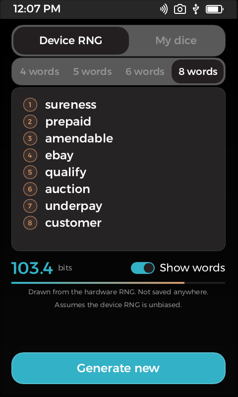
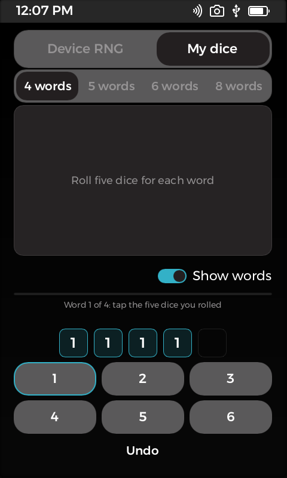
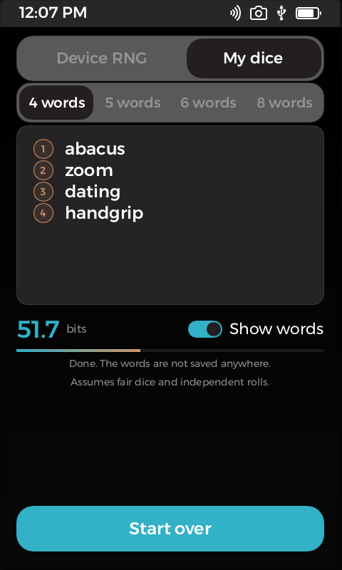
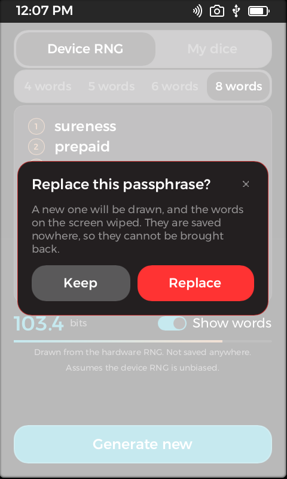

# Passphrase for Passport Prime

A diceware passphrase generator for [KeyOS](https://github.com/Foundation-Devices/KeyOS), the operating system of
Foundation's Passport Prime. Rust, with the Foundation SDK's Slint UI. It has no network, saves nothing, never
logs the words, and wipes what it keeps of them.

[](LICENSE)


| Device RNG, 8 words | My dice | Done | Asks before wiping |
|---|---|---|---|
|  |  |  |  |

**[Watch the 60 fps demo](demo/animations.mp4)** (recorded from the simulator; 83 s, it ends with the words
covering themselves after 30 s without a touch).

## What it is, and what it is not

It draws a random passphrase from the [EFF large wordlist](https://www.eff.org/dice) (7776 words, 12.92 bits per
word) and shows it on the screen: six words are 77.5 bits, eight are 103.4. Use it for a password manager's master
password, a disk-encryption passphrase, or the optional passphrase ("25th word") of a wallet.

It is **not** a seed-phrase generator. A wallet seed is made by the wallet itself from another list of 2048 words
(BIP-39) and carries a checksum; the words from this app are not valid as a seed. This app does not touch keys,
the wallet or any other app, and nothing it shows is sent anywhere. You read the words and write them down.

## Features

- **Device RNG.** Choose 4, 5, 6 or 8 words and tap Generate. The words are drawn with `getrandom`, which the SDK
  routes to the device's hardware random number generator (TRNG). Each index is taken from a random 32-bit value;
  values from the incomplete last block of the 32-bit range are rejected, so every word is exactly equally likely.
- **My dice.** Roll five real dice per word and tap the results. `11111` is the first word of the list
  (`abacus`), `66666` the last (`zoom`), exactly as on the EFF page. This mode does not use the device's RNG at
  all, but it trusts your dice (see Entropy below). Undo takes back a die, or the last finished word.
- **Entropy.** The screen shows the bits of what you have so far, with a gauge. The figure assumes that each
  word is chosen uniformly and independently of the others: with dice, that the dice are fair and every roll is
  independent (a worn or loaded die, or rolls that depend on each other, give fewer bits than shown); with the
  device RNG, that the hardware generator is unbiased. The screen says so under the gauge.
- **Show words.** Covers the words with dots. While they are covered the UI is not given the words at all.
- **No accidental replacement.** Anything that would wipe the passphrase on the screen asks first: Generate new,
  Start over, and switching the mode or the number of words. The dialog defaults to keeping it: tapping outside
  it, or Keep, changes nothing.
- **Idle protection.** After **30 s** without a touch the words cover themselves, after **120 s** everything is
  wiped and the screen goes back to its empty state. A touch is a tap on any control; both times are constants in
  `ui/app.slint` (`Policy`), and the empty screen states them before the first passphrase is drawn.
- **Leaving the app.** When the system hides the app (in the simulator: the launcher or another app comes to the
  front), the words are covered at once, a question that was waiting is dropped, and the words stay covered when
  you come back. The platform runs no timers while an app is hidden (its event loop waits until the app is shown
  again), so the idle timeout cannot count that time. The app measures it itself: on coming back it adds the
  time away to the idle time, and if that reaches 120 s it wipes before anything is shown. What it cannot do is
  wipe by itself *while* hidden: until you come back or the app is closed, the words stay in its memory, covered.
  See Status for what has been tested.
- **Pixel-in.** A new word appears as coarse blocks that sharpen step by step into the real text (11, 7, 4 and
  2 pixel cells); words leave the same way backwards. When one word is added (dice mode) only that word plays
  the effect.

## Memory hygiene

Freeing memory does not erase it. Everything the app keeps of a passphrase is overwritten with volatile zero
stores, which the compiler cannot optimise away, before it is given back (`src/wipe.rs`, covered by unit tests):

- the list of drawn words and the dice digits, when you start over, change mode or word count, generate again,
  when the idle timeout wipes the session, and when the session is dropped;
- the four random bytes read from the RNG, right after use;
- the picture of every word made for the pixel-in effect, and the temporary pixel buffer it is converted from.

What it cannot reach, and you should know about:

- Slint's own copies: the text of a word held by the UI, the pixel data of the effect images once they are handed
  to Slint, text layout and glyph caches, and the frame buffer until the next screen overwrites it. While "Show
  words" is off the app gives the UI no text and no images, which keeps those copies from being made, but copies
  made before cannot be wiped from outside the toolkit.
- Anything below the app: the kernel, the allocator's free lists, the display.

This has been checked in the simulator and by unit tests, not on a device. Nothing here replaces the device's
own isolation of apps.

## Status

Version 0.1.0 runs in the KeyOS **simulator** only. It builds for the device (`armv7a-unknown-xous-elf`, 2.6 MB;
the installer limit is 64 MiB) but is **not signed, and has never been run on a Passport Prime**. In particular
the randomness it gets in the simulator comes from the simulator's own generator, not from hardware: do not use
a passphrase made there for anything real.

Leaving the app was tried in the simulator by sending it to the launcher and back: after a few seconds the words
come back covered, and after more than 120 s the app comes back empty. **Not tested:** what the Prime's lock
screen does. The SDK documents an input message `Hidden` ("the app is getting minimized and hidden in the
background") and the app reacts to it, but I have not confirmed that locking the device sends it, and an app
cannot see the lock state without a permission I have not looked into. Please treat locking as unverified until
it has been tried on a device.

## Build and run

You need the [Foundation SDK](https://foundation.xyz/developers) (it brings Nix, the Rust toolchain and the
simulator).

```sh
foundation develop          # enter the SDK shell
foundation sim              # build and run in the simulator, no device needed
foundation build --release  # compile for the device; stops at signing until you create an identity
```

The logic has no KeyOS dependency, so its 20 unit tests (wordlist, dice mapping, bias rejection, uniformity,
failing RNG, pixel frames, wiping) run in a plain Rust crate:

```sh
cd tools/host-tests && cargo test
```

## How it is put together

| Path | What |
|---|---|
| `src/passphrase.rs` | Word selection, entropy, the RNG call |
| `src/pixel.rs`, `src/glyphs.rs` | Frames of the pixel-in effect. Slint cannot pixelate text, so a word is composed from glyph masks and averaged over cells |
| `src/wipe.rs` | Volatile zeroing of strings, byte buffers and word lists |
| `src/main.rs` | The session, the callbacks, keeping the UI's rows in step with it |
| `ui/app.slint`, `ui/callbacks.slint` | The screen, and the interface between it and Rust |
| `tools/gen-glyphs` | Development tool that rasterised `src/glyphs.rs` from Montserrat Medium |
| `tools/host-tests` | The plain-crate test harness |

## Notes for other KeyOS developers

Things this project ran into on the simulator (x86); the device has a much slower CPU, so treat them as
directions, not numbers for the device:

- While anything animates, the platform redraws without sleeping, limited only by the panel (40 FPS in the SDK).
  Steps driven by a `Timer` let the app sleep in between, so the effects here are timer steps, not `animate`.
- The software renderer works by scanline and keeps at most three repaint rectangles, merging the rest into the
  pair that grows least. Things moving far apart become one large box. Gradients cost many times more per pixel
  than flat fills; `opacity` makes a layer, a colour with alpha does not.
- A `Timer` is started by switching its `running` property; `restart()` did not start it here.
- A raster image is bundled as raw pixels (a leftover 110 px template image made the bundle 3.4 MB larger).
- Slint 1.17's software renderer has an off-by-one in `Scene::next_line` that trips a `debug_assert` in debug
  builds when an item's bottom edge equals the first line of a later repaint rectangle. `Cargo.toml` turns debug
  assertions off for dependencies so the simulator behaves like the device build.

## License

Copyright (C) 2026 Nikita Miroshnichenko. Released under the **GNU General Public License v3.0 or later**, see
[LICENSE](LICENSE): you may use, study, change and share it, but anyone who distributes it or a work based on it
must release the source under the same terms. Third-party material (the EFF wordlist, Montserrat-derived glyph
masks, Foundation SDK scaffolding) is listed with its licences in [NOTICE](NOTICE).

This project is not affiliated with or endorsed by Foundation Devices, Inc.

Built with an AI coding assistant (Claude Code) under my direction; the commit trailers say so. The tests and the
simulator runs described here are real. Nothing has been audited.
